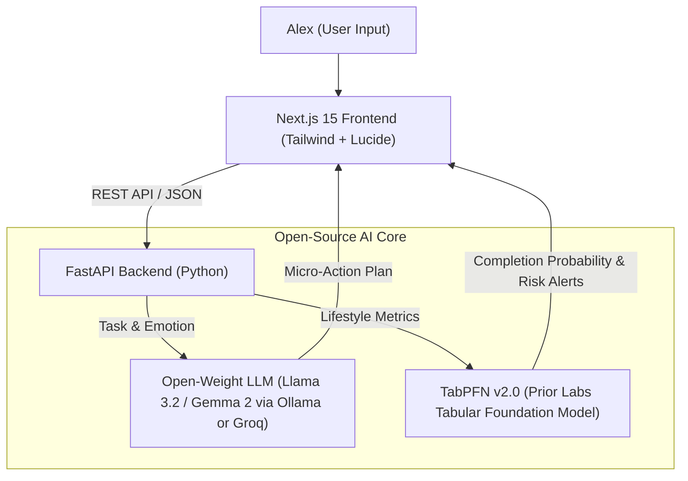

# 改善 KAIZEN — The Gentle Habit & Focus Companion

> **Built for Alex to overcome ADHD task paralysis and burnout using open-source AI.**  
> *Official submission for the [Hacktoberfest 2026 Weekend Challenge: Build for a Friend](https://dev.to/challenges/hacktoberfest-weekend-2026-10-01).*

[](https://hacktoberfest.com)
[](https://nextjs.org)
[](https://fastapi.tiangolo.com)
[](https://priorlabs.ai)
[](LICENSE)

---

## 📖 The Story: Why I Built Kaizen for Alex

My friend **Alex** is extraordinarily talented, but like millions of people living with ADHD, academic stress, and sensory overload, they regularly suffer from **task paralysis**. When faced with daunting assignments or messy spaces, their nervous system treats a long to-do list like an existential threat, freezing them in place for hours.

Traditional productivity tools only compounded the stress:
> *"Every productivity app makes me feel like a failure. They demand strict 45-minute Pomodoros and shower me with angry red warning badges when I slip up."* — Alex

**Kaizen (改善)** was born to replace intimidation with kindness. Rooted in the Japanese philosophy of small, continuous 2-minute micro-improvements, Kaizen provides:
1. **Effortless 2-Minute Task Deconstruction:** Breaks monolithic anxiety-inducing goals into painless, atomic micro-actions with a built-in momentum timer.
2. **Habit & Energy Forecasting with TabPFN:** Learns from daily lifestyle patterns (sleep, screen time, hydration, movement) to predict habit completion probability and warn of burnout slumps before they happen.

### Alex's Real Feedback:
> *"I was staring at my screen for three hours unable to write my lab report. Kaizen didn't tell me to finish the paper—it told me to open the document, type just the title, and drink a glass of water. Two minutes later, my heart rate had slowed down, and I wrote the first paragraph without feeling panicked. This is the first AI tool that calms my nervous system instead of stressing me out."*

---

## 🏗️ System Architecture

Kaizen is decoupled into a slick modern **Next.js 15** frontend and a dedicated **FastAPI** Python AI microservice:



---

## 🔓 Why Open Innovation Matters for Kaizen

In compliance with the Hacktoberfest theme, open innovation is the essential backbone of Kaizen:

1. **🔒 Radical Privacy for Mental Health & Daily Reflection:**  
   Daily logs tracking burnout, emotional paralysis, and sleep deficits are deeply personal. Commercial closed-source AI platforms ingest user logs for model re-training. With local open-weight models (Ollama) and local TabPFN execution, **Alex's intimate reflections never leave their machine**.
2. **💸 Zero Predatory Subscription Barriers:**  
   Closed-source productivity chatbots charge \$20/month. A friend struggling with executive dysfunction should never face a financial paywall to access focus.
3. **⚡ Sovereignty Over System Prompts & Predictability:**  
   Closed APIs suffer from silent model deprecations, guardrail drift, and sudden behavioral changes. Open-weight models (Llama 3.2, Gemma 2) and TabPFN ensure Kaizen remains gentle, deterministic, and dependable.

---

## 🚀 Quickstart Guide

### 1. Backend Setup (FastAPI & TabPFN)

```bash
cd backend

# Create & activate a Python environment (Python 3.12 recommended)
python -m venv .venv
# On Windows:
.venv\Scripts\activate
# On Mac/Linux:
# source .venv/bin/activate

pip install -r requirements.txt

# Start FastAPI server (runs on port 8000)
python -m app.main
```

### 2. Frontend Setup (Next.js 15)

In a new terminal:
```bash
cd frontend

npm install
npm run dev
```

Open `http://localhost:3000` in your browser.

---

## 🏆 Hacktoberfest 2026 Tracks Entered

* **Overall Grand Prize ($250):** Hacktoberfest Weekend Challenge: Build for a Friend.
* **Best Use of TabPFN ($200):** Leverages Prior Labs' TabPFN v2.0 tabular foundation model to forecast personal habit rhythm and spot burnout thresholds from CSV logs.
* **Best Use of Render ($200):** Deployable with native `render.yaml` Blueprint.

---

## 📄 License

Distributed under the **MIT License**. See [`LICENSE`](LICENSE) for details.
