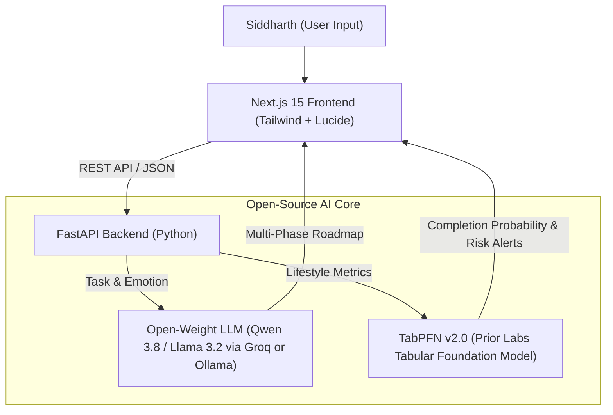

*This is a submission for the [Hacktoberfest Weekend Challenge: Build for a Friend](https://dev.to/challenges/hacktoberfest-weekend-2026-10-01)*

---

## What I Built

I built **Kaizen (改善)** specifically for my friend **Siddharth**.

Siddharth is a brilliant developer and creator who lives with **diagnosed anxiety** and frequently experiences acute **task paralysis**. When faced with large academic projects, messy environments, or multi-step work deadlines, his nervous system perceives the towering to-do list as an existential threat, triggering an immediate fight-or-flight freeze.

Traditional productivity tools only compounded the anxiety:
> *"When my anxiety flares up, a to-do list looks like a wall of threats. Traditional apps demand rigid 45-minute blocks and slap red guilt badges on missed goals. My heart starts pounding before I've even touched my desk."* — Siddharth

**Kaizen** approaches focus through empathy and nervous system regulation instead of pressure. Rooted in the Japanese concept of continuous, incremental micro-improvements, Kaizen provides two core pillars:

1. **Multi-Phase Task Deconstruction & Interactive Roadmap:**
   - **Phase 1: Zero-Resistance Ignition (<= 2 min):** Pure physical, effortless entry points to soothe panic and cross the activation threshold.
   - **Phase 2: Core Momentum Milestones (5–15 min):** Concrete, bite-sized execution chunks with friction-breaker rules to bypass perfectionism and overthinking.
   - **Phase 3: Clean Wrap-Up Landing (2–5 min):** Context bookmarking and guilt-free closure so he can step away cleanly without burnout.
   - Includes per-step timer binding, progress checklists, and 1-click Markdown export.
2. **The Habit Rhythm Forecaster:** Powered by **TabPFN (Prior Labs)**, it analyzes Siddharth's daily lifestyle metrics (sleep duration, screen time, hydration, movement, and stress) to forecast habit completion likelihood and pinpoint burnout slumps before they spiral out of control.

### Siddharth's Real Reaction:
> *"I spent three hours staring blankly at my laptop, paralyzed by a 15-page systems report, feeling that familiar chest tightness. Kaizen didn't tell me to finish the paper—it told me to open the document, type just the title, and drink a glass of water. Two minutes later, my heart rate had slowed down, the dread subsided, and I wrote the first section. This is the first AI companion that calms my nervous system down instead of lecturing me."*

---

## Demo

* **Live Demo URL:** [https://kaizen-companion.onrender.com](https://kaizen-companion.onrender.com) *(or your deployed URL)*
* **Interactive Features:**
  * **Next.js 15 Zen Interface:** Calming, distraction-free UI with soft natural tones and real-time interaction.
  * **Multi-Phase Task Deconstruction:** Step-by-step interactive cards with per-step timers, friction-breaker badges, and cognitive rationale.
  * **TabPFN Rhythm Forecaster:** Analyzes sleep vs. screen time friction and calculates the probability of completing habits today.

---

## Code

* **GitHub Repository:** [https://github.com/your-username/kaizen-hf26](https://github.com/your-username/kaizen-hf26)
* **License:** Permissive **MIT License**

---

## How I Built It

Kaizen is engineered on open-source foundations:

### 1. Dual Open-Source AI Architecture

* **Prior Labs' TabPFN v2.0 (Tabular Foundation Model):**  
  Unlike traditional machine learning approaches that require tedious feature engineering and hyperparameter tuning, TabPFN is a Prior-Data Fitted Network that performs in-context learning directly on tabular data in milliseconds. We feed Siddharth's 35-day habit log into `TabPFNClassifier` to evaluate how subtle shifts (e.g. dropping screen time by 1.5h or sleeping 7h+) dramatically boost his focus probability.
* **Open-Weight Language Models (Qwen 3.8 / Llama 3.2):**  
  We connect task deconstruction to open-weight models running locally via **Ollama** (`ollama run llama3.2`) or via Groq open-weight inference (`qwen/qwen3.8-27b`). We also implemented an offline heuristic fallback so Kaizen can run 100% offline without dependencies or API keys.

### 2. Full-Stack Decoupled Architecture

* **Frontend:** Next.js 15, React 19, Tailwind CSS, Lucide icons.
* **Backend:** FastAPI (Python 3.12) running TabPFN inference and open-weight model integration.

---

## Why Does Open Innovation Matter?

In line with Hacktoberfest 2026's *"AI belongs to everyone"* mission, building Kaizen with open innovation wasn't just a design choice—it was an ethical necessity:

1. **Radical Privacy for Mental Health & Vulnerable Daily Logs:**  
   Daily logs detailing anxiety states, panic triggers, sleep deprivation, and stress are deeply sensitive. Proprietary closed-source AI platforms routinely ingest user prompts to train commercial models. With open-weight models (running on Ollama) and local TabPFN execution, **Siddharth's personal mental health logs never leave his device**.
2. **Zero Predatory Subscription Barriers:**  
   Closed commercial productivity chatbots charge $20/month subscriptions. For individuals grappling with diagnosed anxiety and executive dysfunction, financial paywalls should never be a barrier to accessing focus.
3. **Deterministic Guardrails & Model Sovereignty:**  
   Closed APIs frequently suffer from sudden system prompt shifts, unexpected rate limits, and model deprecations. With open weights (Qwen 3.8, Llama 3.2, Gemma 2, TabPFN), Kaizen remains predictable, resilient, and fully under the user's control.

---

## My Agent Session

We pair-programmed and built Kaizen using our AI coding assistant:

<!-- DevRelay Agent Session Embed -->


---

## Prize Categories

We are entering Kaizen into the following prize tracks:

* **Hacktoberfest Weekend Challenge: Build for a Friend (Overall Grand Prize)**
* **Best Use of TabPFN ($200):** Leverages Prior Labs' TabPFN tabular foundation model (`TabPFNClassifier`) to discover non-linear lifestyle patterns, forecast habit success rates, and warn against burnout slumps from historical CSV logs.
* **Best Use of Render ($200):** Ready for cloud deployment with Next.js and FastAPI.
